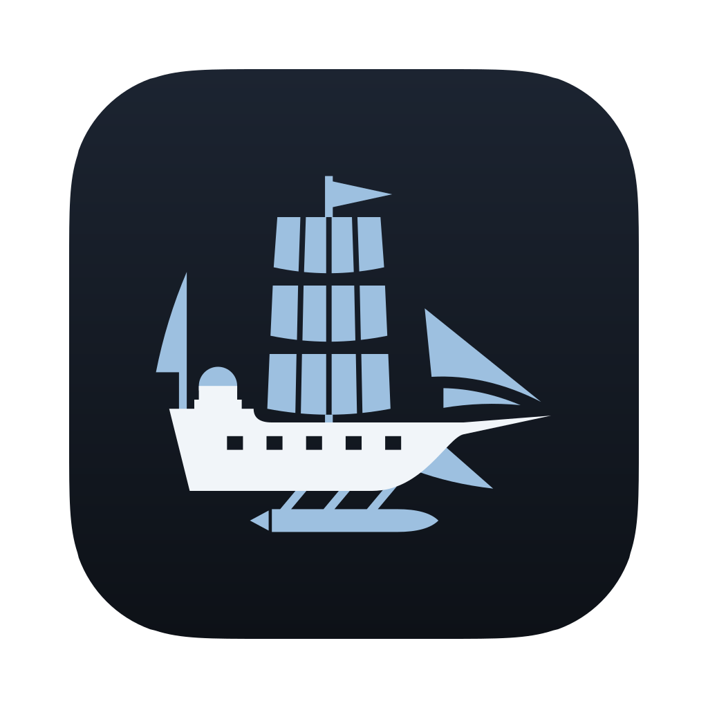
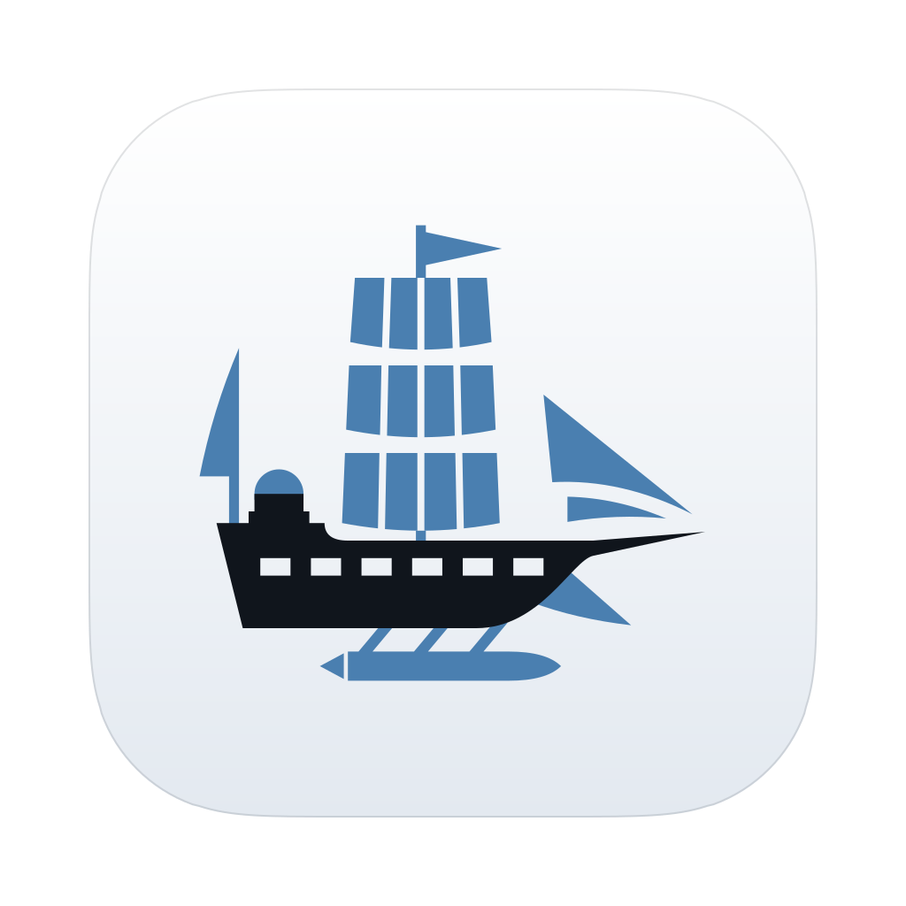

<p align="center">
  <picture>
    <source media="(prefers-color-scheme: dark)" srcset="logo-dark.svg">
    
  </picture>
</p>

<p align="center">
  
  
</p>

# Frigate's artwork

Frigate's mark, logo and app icons: the logo at the top of the landing page and the READMEs, and the icons of
`Frigate Black 2.app` and `Frigate White 2.app` and of the program's window on Linux and Windows. Every file is drawn
as code by [tools/frigate_logo.py](tools/frigate_logo.py), so a change is a change to that script. Nothing here comes
from the game: no Pokémon, no Nintendo artwork and no file of the ROM.

## The design

Frigate's mark is a three-masted frigate drawn flat: a steel-blue rig over a hull with its gunport stripe cut out, so
the stripe shows whatever the ship sits on. On White 2's icon that gives the classic black hull with a white chequered
stripe; on Black 2's, the reverse, a white hull with black gunports: the plate carries the version, and the ship is its
negative. The cold steel blue nods to the games' icy theme, and the FRIGATE wordmark is drawn from geometric shapes,
the ends of its bars filled forward like the jib. The ship sails to the right.

## Files

| File | What it is | Where it is used |
| --- | --- | --- |
| `logo.svg` | The mark and the FRIGATE wordmark, for light backgrounds | The top of [.github/README.md](../../../.github/README.md) (the landing page), [port/README.md](../../README.md) and this file, chosen by colour scheme with `logo-dark.svg` |
| `logo-dark.svg` | The same, for dark backgrounds | As `logo.svg` |
| `logo.png`, `logo-dark.png` | The logos rendered 1200 px wide (1200 x 333) | Wherever an SVG can't go: a forum post, a slide, a social card |
| `mark.svg`, `mark-dark.svg` | The ship alone, for light and for dark backgrounds | Square places: an avatar, a favicon |
| `icon-black2.svg`, `icon-white2.svg` | The app icons: the ship on Black 2's dark plate or White 2's light one, on Apple's 1024 px macOS icon grid | The sources of the two masters below |
| `icon-black2-1024.png`, `icon-white2-1024.png` | The icons' 1024 x 1024 masters, transparent outside the plate | The build: `PORT_APP_ICON` in [CMakeLists.txt](../../CMakeLists.txt) picks the version's, and [How the build uses the icons](#how-the-build-uses-the-icons) says what is made from it |
| [tools/frigate_logo.py](tools/frigate_logo.py) | Writes the six SVGs: every shape, colour and spacing is set there | Run by `render.py`, and by the test `assets_branding` |
| [tools/render.py](tools/render.py) | Writes the SVGs, renders the four PNGs, and with `--sheet` a contact sheet (macOS) | [Changing the artwork](#changing-the-artwork) |
| [tools/sheet.swift](tools/sheet.swift) | The renderer: SVGs to PNGs with AppKit, and contact sheets | Built by `render.py` in a temporary directory |
| [tools/contact.py](tools/contact.py) | Lays out the contact sheet: the logos on GitHub's backgrounds, every icon and mark from 128 down to 16 px | `render.py --sheet` |

Each SVG has a `<title>` ("Frigate", or "Frigate Black 2" and "Frigate White 2" for the icons) and draws with paths
alone, plus one gradient on each icon's plate: no text, fonts or images, so GitHub, browsers and macOS draw them alike.

## Colours

| Name | Hex | Used for | Contrast |
| --- | --- | --- | --- |
| Ink | `#10151C` | The hull and the wordmark on light backgrounds | 18:1 on white |
| Steel | `#4A7FB0` | The rig (masts, sails, jib and pennant) on light backgrounds | 4.2:1 on white |
| Snow | `#F1F5F9` | The hull and the wordmark on dark backgrounds | 17:1 on `#0D1117` |
| Ice | `#9DC0E0` | The rig on dark backgrounds | 10:1 on `#0D1117` |

Black 2's plate runs from `#1C2431` at the top to `#0D1117` and carries the dark-background ship; White 2's runs from
`#FFFFFF` to `#E3E9F0`, with a faint 2 px edge of ink at 12% just inside it so that it keeps its shape on white, and
carries the light-background ship.

## Using the logo

Neither logo file switches colours by itself: they are a pair. On a page that follows the reader's colour scheme, as
GitHub does, use both:

```html
<picture>
  <source media="(prefers-color-scheme: dark)" srcset="logo-dark.svg">
  
</picture>
```

`mark.svg` is for light backgrounds only, and `mark-dark.svg` for dark ones. The logo reads down to about 160 px wide.
The icons read as three masts from 32 px; at 16 px they show only a ship's shape. Use the files as they are: a new
colour or shape belongs in `frigate_logo.py`, so that every file keeps the same drawing.

## How the build uses the icons

Nothing made from the masters is committed: the build makes it again whenever a master changes.

- **The macOS app's icon:** [app/macos/make_icns.sh](../../app/macos/make_icns.sh) scales the version's master with
  `sips` to the ten images of a macOS icon set (16 to 512 points at 1x and 2x) and packs them with `iconutil` into an
  `.icns` in the build directory ([cmake/macos_app.cmake](../../cmake/macos_app.cmake)).
  [make_app.sh](../../app/macos/make_app.sh) puts it in the app as `Contents/Resources/AppIcon.icns`, which the
  Info.plist's `CFBundleIconFile` names; Finder, the Dock and the About window show it. The program's own window sets
  no icon on macOS, so the Dock keeps the app's.
- **The window's icon on Linux and Windows:** [tools/gen_window_icon.c](../../tools/gen_window_icon.c), built for the
  machine that builds, trims the master's transparent margin (the macOS grid's, which icons on Linux and Windows don't
  have) and averages it down to a 64 px bitmap in a C file ([cmake/app.cmake](../../cmake/app.cmake));
  [app/window_icon.c](../../app/window_icon.c) gives it to the window with `SDL_SetWindowIcon`, for the taskbar and
  the title bar.

The tests: `assets_branding` ([tests/assets/test_branding.py](../../tests/assets/test_branding.py)) checks that the
SVGs are what `frigate_logo.py` writes, that they draw with paths alone, and the PNGs' sizes; `app_make_app` checks the
`.icns` and that the app holds it; `app_window_icon_plain` and `_sanitized` check the window's bitmap.

## Changing the artwork

1. Change [tools/frigate_logo.py](tools/frigate_logo.py), the only place the shapes and colours are set.
2. On macOS, with Xcode's command line tools (for `swiftc`), write the SVGs and render the PNGs again, with a contact
   sheet to look at, outside the tree or under the ignored `build/`:

   ```sh
   python3 port/assets/branding/tools/render.py --sheet build/branding/contact-sheet.png
   ```

   Look at the sheet: the logos on GitHub's light and dark backgrounds, and every icon and mark at 128, 64, 32 and
   16 px, the last two also enlarged to show their pixels.
3. Check and see the result in the product: `ctest --test-dir build/port -R 'assets_branding|app_window_icon'`, then
   `cmake --build build/port --target frigate-black2_app` and open the app (the same for White 2 in its own build).
4. Commit the script, the SVGs and the PNGs together. The PNGs are rendered by AppKit, so they come from a Mac; on
   another system `frigate_logo.py` still writes the SVGs, but the masters stay as they were until a Mac renders them.

## License

The artwork is part of this repository and under its license, the [GNU GPL v3.0](../../../LICENSE): it is original
work made for Frigate, drawn as code in this tree, and nothing in it needed another license. In the GPL's terms, its
source is `tools/frigate_logo.py` with the SVGs it writes; the PNGs are renders of them. The icons' plate follows
Apple's macOS icon grid, the rounded square that macOS app icons share. The license covers the artwork, not a name: a
build that isn't Frigate's, such as a fork under another name, should carry its own name and icon, as it takes its own
bundle identifier ([port/README.md](../../README.md#the-macos-app)).

## Known limits

- The icons' 16 and 32 px images are scaled from the master, not drawn for their size; an `.icns` can carry
  hand-tuned small images, which would read better.
- macOS 26 shows icons from a plain `.icns` inside a dark plate of its own at 16 and 32 px, as it does other apps'
  `.icns` icons; from 64 px up it shows Frigate's plate as drawn. An Icon Composer icon (macOS 26's layered format,
  with the plate, the rig and the hull as layers) would avoid that.
- No trademark search was made. Tall ships are a common symbol; what sets this one apart is the cut-out stripe, the
  curved feet of the sails and the blue rig over a dark or light hull.
